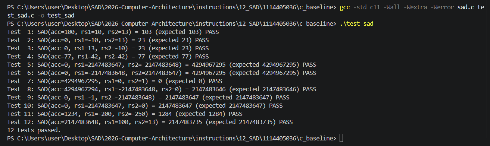

# CP1：C baseline — SAD

## 1. 本次目標

完成 SAD 的 C 參考實作，建立至少 10 組包含邊界值的測試向量，
並透過測試程式確認 `rd_new = rd_old + |signed(rs1) - signed(rs2)|`
及 32 位元 wrap-around 行為符合題目規格。

## 2. 設計內容

本 CP 附上：
- `c_baseline/` 原始碼：[`sad.c`](../src/c_baseline/sad.c)、[`sad.h`](../src/c_baseline/sad.h)、[`test_sad.c`](../src/c_baseline/test_sad.c)
- 12 組測資與預期輸出：[`test_vectors.csv`](../src/c_baseline/test_vectors.csv)

### 2.1 函式設計

函式介面為 `sad_accumulate(uint32_t accumulator, int32_t rs1, int32_t rs2)`。
先以 32-bit 二補數減法計算差值 `d = rs1 − rs2`（與硬體減法器相同，
溢位時取低 32 位元），再依 `d` 的符號位元決定是否取二補數負值，得到
`|d|`，最後加到 `uint32_t` 累加器並回傳。差值以 `uint32_t` 運算，因此
`d = 0x80000000` 取負後仍是 `0x80000000`，與 `ABS` 的邊界規則一致；
加法同樣以 `2^32` 取模。函式不修改輸入，而是計算完成後回傳新的 `rd` 值。

### 2.2 測資設計

共 12 組測資，與 [`test_sad.c`](../src/c_baseline/test_sad.c) 的 `test_cases[]` 同順序、同內容（以下數值取自 [`test_vectors.csv`](../src/c_baseline/test_vectors.csv)，十進位）：

| # | `rd_old` | `rs1` | `rs2` | 預期 `rd_new` | 說明（取自 CSV） |
|---:|---:|---:|---:|---:|---|
| 1 | 100 | 10 | 13 | 103 | basic vector |
| 2 | 0 | -10 | 13 | 23 | negative and positive |
| 3 | 0 | 13 | -10 | 23 | positive and negative |
| 4 | 77 | 42 | 42 | 77 | zero absolute difference |
| 5 | 0 | 2147483647 | -2147483648 | 1 | subtraction overflow d wraps to -1 so abs is 1 |
| 6 | 0 | -2147483648 | 2147483647 | 1 | reversed subtraction overflow |
| 7 | 4294967295 | 0 | 1 | 0 | accumulator wraparound |
| 8 | 4294967294 | -2147483648 | 0 | 2147483646 | absolute value overflow 0x80000000 |
| 9 | 0 | -1 | -2147483648 | 2147483647 | minimum signed boundary |
| 10 | 0 | 2147483647 | 0 | 2147483647 | maximum signed boundary |
| 11 | 1234 | -200 | -250 | 1284 | both operands negative |
| 12 | 2147483648 | 100 | 13 | 2147483735 | accumulator high bit |

測資 #1 是基本範例；#2、#3 檢查正負混合與交換運算元後結果仍相同；
#4 檢查兩個運算元相等時的零差值。#5、#6 使用 `INT32_MAX` 與
`INT32_MIN`，檢查減法溢位後 `d` 回繞成 `-1`（`0xFFFFFFFF`）、
絕對值為 `1`；#8 檢查 `|0x80000000|` 仍為 `0x80000000` 的絕對值溢位
邊界；#9、#10 分別檢查最小與最大 signed 邊界。#7、#8、#12 檢查累加器
接近或超過 32 位元範圍時的 wrap-around 與最高位元處理；#11 則檢查兩個
運算元都是負數。因此 12 組涵蓋一般情況、運算元順序、零差、正負號、
signed 邊界、減法溢位、絕對值溢位與累加溢位。

### 2.3 關鍵決策的 5 Whys

| 層 | 為什麼？ | 回答（可驗證） |
|---|---|---|
| Why 1 | 為什麼要先做 `rs1 − rs2` 再取絕對值，而不是先比較大小？ | 題目規定運算溢位取低 32 位元，`ABSDIFF` 也明訂減法與絕對值皆以 32-bit wrap 計算；先比較大小等於改用「數學量值」語意，#5、#6 會得到 `0xFFFFFFFF` 而不是 `1`。 |
| Why 2 | 為什麼 `rs1 < rs2` 時不會得到負的距離？ | `d` 的符號位元為 1 時做二補數取負；#2 的 `d = −23` 取負後為 23。 |
| Why 3 | 為什麼要轉成 `uint32_t` 後再取負？ | `−INT32_MIN` 在 signed 32-bit 會溢位（未定義行為），改用 unsigned 的 `0 − d` 有明確定義；#8 驗證 `0 − 0x80000000 = 0x80000000`。 |
| Why 4 | 為什麼累加器使用 `uint32_t`？ | 題目規定結果保留低 32 位元，unsigned 加法會以 `2^32` 取模；#7 驗證 `0xFFFFFFFF + 1` 變成 0。 |
| Why 5 | 為什麼函式回傳結果而不直接修改輸入？ | 這符合先讀取 `rd_old`、`rs1`、`rs2`，計算完成後才寫回 `rd_new` 的指令語意，也能讓每組測資獨立驗證。 |

## 3. 結果與分析

測試程式預期使用 C11 編譯，並開啟警告與錯誤選項：

```text
cc -std=c11 -Wall -Wextra -Werror sad.c test_sad.c -o test_sad
./test_sad
```

成功輸出（逐筆印出 12 行，最後一行為 `12 tests passed.`）：

```text
Test  1: SAD(acc=100, rs1=10, rs2=13) = 103 (expected 103) PASS
Test  2: SAD(acc=0, rs1=-10, rs2=13) = 23 (expected 23) PASS
Test  3: SAD(acc=0, rs1=13, rs2=-10) = 23 (expected 23) PASS
Test  4: SAD(acc=77, rs1=42, rs2=42) = 77 (expected 77) PASS
Test  5: SAD(acc=0, rs1=2147483647, rs2=-2147483648) = 1 (expected 1) PASS
Test  6: SAD(acc=0, rs1=-2147483648, rs2=2147483647) = 1 (expected 1) PASS
Test  7: SAD(acc=4294967295, rs1=0, rs2=1) = 0 (expected 0) PASS
Test  8: SAD(acc=4294967294, rs1=-2147483648, rs2=0) = 2147483646 (expected 2147483646) PASS
Test  9: SAD(acc=0, rs1=-1, rs2=-2147483648) = 2147483647 (expected 2147483647) PASS
Test 10: SAD(acc=0, rs1=2147483647, rs2=0) = 2147483647 (expected 2147483647) PASS
Test 11: SAD(acc=1234, rs1=-200, rs2=-250) = 1284 (expected 1284) PASS
Test 12: SAD(acc=2147483648, rs1=100, rs2=13) = 2147483735 (expected 2147483735) PASS
12 tests passed.
```

實際執行（由 Claude 協助）：在 Windows 11 上以 gcc 16.2.0（MSYS2 UCRT64）使用上述
選項編譯修訂前的版本，沒有任何警告，結束狀態為 0，12 組全部 `PASS`（該次
#5、#6 的預期值仍是 `4294967295`）。改為 wrap 語意後，只有 #5、#6 的預期值
與輸出差異為 `1`，其餘 10 組與上表相同；修訂後的 `sad.c` 已逐條核對，但未
重新截圖。以同樣方式執行早期版本（commit `28e0557`）則在第 7 組失敗：
`expected=0xfffffffe, actual=0x00000000`，與第 4 節描述的問題相符。



圖 1：在 VS Code 終端機以 gcc 編譯並執行 `test_sad`，12 組測資皆為 `PASS`，
最後輸出 `12 tests passed.`（截圖已裁切為終端機區域）。截圖攝於語意修訂前，
當時 #5、#6 的預期值為 `4294967295`；改為 32-bit wrap 語意後，這兩組的輸出
改為 `1`，其餘 10 組不變。

測試程式會依序執行 `test_cases[]` 的 12 組資料，逐筆比較實際結果與
預期值並印出 `PASS` 或 `FAIL`；全部通過時最後一行為 `12 tests passed.`，
只要有任何一組失敗，最後一行會改成 `N/12 tests passed.` 並以非零狀態
結束。結果涵蓋基本運算、正負混合、零差、減法溢位、絕對值溢位、
signed 邊界、累加器最高位元及 unsigned wrap-around。

本實作將 `rs1`、`rs2` 視為 signed 32-bit，將累加器與回傳值視為
unsigned 32-bit。測資 #5 的 `d = 2147483647 - (-2147483648)` 在 32 位元
下回繞成 `0xFFFFFFFF`（即 `-1`），絕對值為 `1`；測資 #8 的
`|0x80000000|` 仍為 `0x80000000`；測資 #7 的累加為
`0xFFFFFFFF + 1 = 0`（保留低 32 位元）。

## 4. 遭遇的問題與解法

實際遇到的問題是測資 #7 的預期值寫錯。早期版本把 `0xFFFFFFFF + |0 - 1|`
的預期結果寫成 `0xFFFFFFFE`，但差值是 1，`0xFFFFFFFF + 1` 在 32 位元下
會回繞成 `0`。這個錯誤同時出現在 `test_sad.c` 與 `test_vectors.csv`，照原樣
編譯執行時，測試會在第 7 組失敗。解法是回頭手算 `0xFFFFFFFF + 1 = 2^32`，
保留低 32 位元後為 0，並在兩個檔案都改成 0；之後也讓 CSV 與 `test_sad.c`
的 12 組測資內容與順序完全一致，避免兩份資料各自不同。

第二個問題在 CP3 撰寫語意規格時發現。原版 `sad.c` 先比較 `rs1`、`rs2`
再以大減小，等於採用「數學量值」語意：`INT32_MAX` 與 `INT32_MIN` 相減會
得到 `0xFFFFFFFF`。但 `HOMEWORK.md` §6.0 規定運算溢位取低 32 位元，
依此定義差值 `d` 會回繞成 `-1`，絕對值為 `1`。解法是把 `sad.c` 改成
「先相減、再依符號位元取二補數負值」，並同步修正 `test_sad.c` 與
`test_vectors.csv` 的 #5、#6；改完後 12 組仍全部通過，且與 CP2、CP3 的
語意一致。

## 5. 白話說明

SAD 就是量兩個數字的距離，再把這個距離加到目前的總和。程式先直接
相減，得到一個 32 位元的差值；如果差值是負的，就用二補數把它變成
正的距離。這種做法和課本對這條指令的定義一致：相減和取絕對值都只
保留低 32 位元，所以連最大正數減最小負數這種極端情況也照同一個規則
處理，不會因為先比較大小而得到不同答案。最後把距離加到總和，總和
超過範圍時同樣只保留最右邊 32 位元。用最大值、最小值與溢位測資
檢查，確認實作符合規格。

## 6. AI 使用說明

本次使用 GitHub Copilot（VS Code）協助閱讀題目規格、整理報告內容、
建立 5 Whys 推理鏈，以及檢查測資是否涵蓋 signed 邊界和累加溢位。
另使用 Claude（Claude Sonnet 5.5）：commit `44ba0cd`（共同作者為 Claude）修正了
測資 #7 的預期值、RV32IM 指令數與文件連結；本次協助比對 `HOMEWORK.md`
的 wrap 定義、找出原版「先比較大小」與規格不符之處、改寫 `sad.c`，以及
同步修正 `test_sad.c`、`test_vectors.csv` 與本報告的測資表、5 Whys 和
「遭遇的問題與解法」。
報告內容由本組依照實際的 `sad.c`、`test_sad.c` 與
`test_vectors.csv` 逐項核對並修改，確認函式介面、12 組輸入、預期值、
unsigned 差值處理與編譯指令都和本組實作一致；AI 產生的內容未直接在
未驗證的情況下使用。
