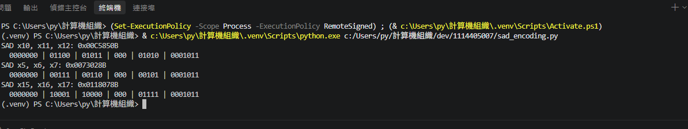

# CP3：指令規格與編碼 — SAD

## 1. 本次目標

定義 `SAD`（絕對差累加）自訂指令的語意規格、R-type 編碼與機器碼範例，
並比較 SAD 自訂指令與 RV32IM baseline 的靜態／動態指令數。
規格依 `HOMEWORK.md` §6.0、§6.2 撰寫，可直接作為 CP4–CP6 硬體設計的輸入。

## 2. 設計內容

本 CP 附上：

- 指令規格（語意、編碼、測試向量）：[`instructions/SAD/README.md`](../instructions/SAD/README.md)
- 對照用的 RV32IM baseline：[`src/rv32im/`](../src/rv32im/)
- 12 組測試向量：[`src/c_baseline/test_vectors.csv`](../src/c_baseline/test_vectors.csv)

以下依 `HOMEWORK.md` §6.7 的規格格式排列：語意（公式）→ 運算元與定義域 →
結果範圍 → 邊界條件與溢位處理 → 測試向量 → 對應的 RV32IM baseline 片段與指令數；
另外補上 `rd` 的讀寫順序、3 個讀埠、虛擬碼、R-type 編碼與 5 Whys。

### 2.1 語意規格

#### 2.1.1 語意（公式）

```text
rd_new = rd_old + |rs1 − rs2|        （所有運算皆 mod 2^32）
```

拆成三步，每一步都以 32-bit wrap 計算：

```text
d      = (rs1 − rs2) mod 2^32
ad     = (d[31] == 1) ? (0 − d) mod 2^32 : d
rd_new = (rd_old + ad) mod 2^32
```

- `rd_old` 為指令執行前 `rd` 的內容，`rd_new` 為寫回值。
- `d[31]` 為符號位元；`0 − d` 即二補數取負，等同 `~d + 1`。
- 本指令**不飽和**、不 trap、不設定旗標（無 overflow flag）。

#### 2.1.2 運算元與定義域

| 運算元 | 角色 | 寬度 | 定義域 | 說明 |
|---|---|---:|---|---|
| `rs1` | 被減數 | 32 | 任意 32-bit 位元樣式，解讀為有號二補數 `[−2^31, 2^31−1]` | 不限 8-bit 像素，與 `MAXPIX` 不同 |
| `rs2` | 減數 | 32 | 同上 | 與 `rs1` 對稱：交換兩者結果不變 |
| `rd_old` | 累加器（來源） | 32 | 任意 32-bit 位元樣式 | 視為 modulo 2^32 的整數，正負皆可 |
| `rd_new` | 累加器（目的） | 32 | 任意 32-bit 位元樣式 | 寫回 `rd` |

特例：`rs1 = x0` 或 `rs2 = x0` 讀到 0；`rd = x0` 時運算照做但**寫回被丟棄**（與 RISC-V 其他指令一致），因此 `SAD x0, ...` 不具累加效果。

#### 2.1.3 結果範圍

- 位元層級：`0x00000000` – `0xFFFFFFFF`，**32 位元全範圍**都可能出現（因為加法會 wrap）。
- 有號解讀：`−2^31` – `2^31−1`。
- 單看 `|rs1 − rs2|` 一項：`0` – `0x7FFFFFFF`，唯一例外是 `d = 0x80000000` 時結果仍為 `0x80000000`（即 `−2^31`，見 2.1.4 B2）。

#### 2.1.4 邊界條件與溢位（wrap-around）

| 編號 | 條件 | 處理方式 | 例子 |
|---|---|---|---|
| B1 | `rs1 = rs2` | `ad = 0`，`rd` 內容不變（但仍執行寫回） | `rd=77, rs1=rs2=42 → 77` |
| B2 | `d = 0x80000000`（絕對值溢位，與 `ABS` 的 `\|−2^31\|` 同型） | `0 − 0x80000000` 仍為 `0x80000000`，以 wrap 結果為準，不飽和到 `0x7FFFFFFF` | `rd=0, rs1=0x80000000, rs2=0 → 0x80000000` |
| B3 | `rd_old + ad ≥ 2^32`（累加溢位） | 只保留低 32 位元 | `rd=0xFFFFFFFF, rs1=0, rs2=1 → 0x00000000` |
| B4 | `rs1 − rs2` 超出有號範圍（減法溢位） | 先取低 32 位元得到 `d`，再對 `d` 取絕對值 | `rs1=0x7FFFFFFF, rs2=0x80000000 → d=0xFFFFFFFF=−1 → ad=1` |
| B5 | `rd = x0` | 不寫回（結果丟棄） | `SAD x0, x11, x12` 等同空操作 |
| B6 | 連續兩條 SAD 使用同一個 `rd` | 第二條必須讀到第一條的新值（RAW），見 2.1.5 | `SAD x10,...` 緊接 `SAD x10,...` |

B2 與 B4 是本題最容易寫錯的兩個點：**絕對值與減法都不做「大減小」補救**，一律照 32-bit wrap 定義。依據 `HOMEWORK.md` §6.0「運算溢位時取低 32 位元」與 §6.2 `ABSDIFF`「減法與絕對值均以 32-bit wrap 計算」，SAD 未另訂規則，故沿用同一約定。

> **與 CP1/CP2 的一致性**：CP1/CP2 原本採「大減小、保留無號量值」解讀，測資 #5、#6（`INT32_MAX` 與 `INT32_MIN` 相減）的預期值為 `0xFFFFFFFF`；依本節 wrap 定義應為 `1`。本組已統一改為 wrap 語意，並同步修正 `sad.c`、`sad.S`、`test_vectors.csv`、`test_sad.c` 與 CP1/CP2 報告（詳見 CP2 第 4 節）。

#### 2.1.5 `rd` 同時為源與目的：讀寫順序

**規則：先讀、後算、最後寫；同一條指令內三個讀取都必須取得「寫入前」的舊值。**

```text
① 讀 X[rs1]、X[rs2]、X[rd]      （三者皆為舊值，可同週期並行）
② 計算 c + |a − b|
③ 在時脈邊緣寫回 X[rd]
```

1. **不可先寫後讀**：若硬體先更新 `rd` 再讀，會得到 `rd_new = |rs1 − rs2|`，舊累加值被吃掉，等於每次呼叫都把總和歸零。這是本題最典型的實作錯誤。
2. **C 參考模型**必須用暫存變數保存舊值，不能寫成 `rd = rd + ...` 之後又拿 `rd` 當舊值：

   ```c
   uint32_t sad(uint32_t rd_old, uint32_t rs1, uint32_t rs2) {
       uint32_t d  = rs1 - rs2;                      /* mod 2^32 */
       uint32_t ad = (d & 0x80000000u) ? (0u - d) : d;
       return rd_old + ad;                           /* mod 2^32 */
   }
   ```

3. **管線實作**：5 級管線中讀暫存器在 ID、寫回在 WB。若某週期 WB 正寫 `rd`、而 ID 同時要讀同一個 `rd`，必須有 WB→ID forwarding，或採「前半週期寫、後半週期讀」的暫存器檔；否則第二條 SAD 會讀到舊值。
4. **Hazard**：`rd` 同時為源與目的會產生 RAW。相鄰兩條 SAD 共用 `rd` 時，若 forwarding 只有 EX/MEM→EX，仍需 stall 1 個週期（依 CP4 的 datapath 而定）。本 CP 只定義語意，此項列為 CP4–CP6 的設計輸入。

#### 2.1.6 為什麼需要 3 個讀埠

一條 SAD 在**同一個週期**內需要三個獨立的暫存器值：`rd_old`、`rs1`、`rs2`。標準 RV32I 暫存器檔是 2 讀 1 寫，無法同時供應；若只有 2 個讀埠，就必須把指令拆成兩步（先 `ABSDIFF` 再 `ADD`），失去「一條指令完成」的意義。

| 方案 | 讀埠需求 | 優點 | 缺點 |
|---|---|---|---|
| 加第三個讀埠（本組採用） | 3R1W | 單週期完成，指令數最少 | 暫存器檔多一組解碼與多工器，面積/延遲增加 |
| 拆成 `ABSDIFF` + `ADD` | 2R1W | 沿用現有暫存器檔 | 靜態 2 條、動態 2 條，需兩次寫回 |
| 內部累加器狀態暫存器 | 2R1W | 不改暫存器檔 | 跨指令狀態，中斷/context switch 需額外保存，語意不再是純 R-type |
| 兩拍完成 | 2R1W | 面積最小 | CPI 變 2，且需額外控制狀態 |

ISA 層面沒有額外成本：R-type 的 `rd`、`rs1`、`rs2` 欄位本來就存在，第三個讀埠純屬 microarchitecture 的取捨。

#### 2.1.7 測試向量（至少 3 組，含 1 組邊界值）

| # | `rd_old` | `rs1` | `rs2` | `d` | `ad` | `rd_new` | 類型（CSV 編號） |
|---:|---:|---:|---:|---:|---:|---:|---|
| 1 | 100 | 10 | 13 | −3 | 3 | 103 | 基本（#1） |
| 2 | 0 | 13 | −10 | 23 | 23 | 23 | 對稱性（#3） |
| 3 | 77 | 42 | 42 | 0 | 0 | 77 | 零差值邊界 B1（#4） |
| 4 | 0xFFFFFFFF | 0 | 1 | −1 | 1 | 0x00000000 | 累加器 wrap B3（#7） |
| 5 | 0xFFFFFFFE | 0x80000000 | 0 | 0x80000000 | 0x80000000 | 0x7FFFFFFE | 絕對值溢位 B2（#8） |
| 6 | 0 | 0x7FFFFFFF | 0x80000000 | 0xFFFFFFFF | 1 | 1 | 減法溢位 B4（#5） |

上表 6 組為 [`src/c_baseline/test_vectors.csv`](../src/c_baseline/test_vectors.csv) 12 組測資的子集，數值與預期結果完全一致。

對應的 RV32IM baseline 片段與指令數（取 CP2 的 `sad.S`，`a0` 為累加器）：

```asm
sub   t1, a1, a2     # t1 = rs1 − rs2 (mod 2^32)
srai  t2, t1, 31     # t2 = 0 或 0xFFFFFFFF（依 d 的符號位元）
xor   t1, t1, t2     # d ≥ 0 不變；d < 0 變成 ~d
sub   t1, t1, t2     # |d| (mod 2^32)
add   a0, a0, t1     # 累加 (mod 2^32)
```

靜態 5 條、動態 5 條、分支 0 條；SAD 自訂指令為靜態 1 條、動態 1 條、0 條分支。

### 2.2 虛擬碼

**ISA 層（含讀寫順序）**

```text
// SAD rd, rs1, rs2
a  ← X[rs1]                          // 讀 rs1（舊值）
b  ← X[rs2]                          // 讀 rs2（舊值）
c  ← X[rd]                           // 讀 rd（舊累加值）— 必須早於寫回
d  ← (a − b) mod 2^32                // 32-bit wrap
ad ← (d[31] ? (0 − d) : d) mod 2^32  // |d|；0x80000000 → 0x80000000
if rd ≠ x0 then
    X[rd] ← (c + ad) mod 2^32        // 32-bit wrap
end if
```

**C 參考模型**

```c
uint32_t sad(uint32_t rd_old, uint32_t rs1, uint32_t rs2) {
    uint32_t d  = rs1 - rs2;                      /* mod 2^32 */
    uint32_t ad = (d & 0x80000000u) ? (0u - d) : d;
    return rd_old + ad;                           /* mod 2^32 */
}
```

**RTL 資料路徑**

```systemverilog
wire [31:0] d   = rs1 - rs2;                 // 減法器，mod 2^32
wire [31:0] ad  = d[31] ? (~d + 32'd1) : d;  // ABS 電路
wire [31:0] sum = rd_old + ad;               // 加法器，mod 2^32
// 寫回：rd_we = (rd != 5'd0) && valid
```

硬體組成：3 讀埠暫存器檔 + 1 減法器 + ABS（依符號位選擇 NOT/ADD 或 XOR/SUB）+ 1 加法器 + 寫回多工。

### 2.3 編碼

SAD 使用 R-type 格式，`opcode` 固定為 custom-0（`0x0B`）：

```text
31        25 24    20 19    15 14  12 11     7 6       0
+------------+--------+--------+------+--------+---------+
|   funct7   |  rs2   |  rs1   |funct3|   rd   | opcode  |
+------------+--------+--------+------+--------+---------+
   7 bits      5 bits   5 bits  3 bits  5 bits   7 bits
```

| 欄位 | 位元 | 寬度 | 內容 | 說明 |
|---|---|---:|---|---|
| `funct7` | `[31:25]` | 7 | 教師分配（範例用 `0000000`） | 指令碼高 7 位，需與其他 custom-0 指令區別 |
| `rs2` | `[24:20]` | 5 | 暫存器編號 | 第二運算元（減數） |
| `rs1` | `[19:15]` | 5 | 暫存器編號 | 第一運算元（被減數） |
| `funct3` | `[14:12]` | 3 | 教師分配（範例用 `000`） | 指令碼低 3 位 |
| `rd` | `[11:7]` | 5 | 暫存器編號 | 累加器：讀舊值、寫新值 |
| `opcode` | `[6:0]` | 7 | `0001011`（`0x0B`） | custom-0，固定不變 |

欄位組合公式：

```text
encoding = (funct7 << 25) | (rs2 << 20) | (rs1 << 15)
         | (funct3 << 12) | (rd << 7) | 0x0B
```

> **注意**：`HOMEWORK.md` §四規定 `funct3`、`funct7` 由教師分配，目前課程資料未公布正式值。
> 本節與 2.4 節的 `0000000`／`000` 只是**佔位假設值**，用來示範欄位對齊與機器碼計算，
> 不代表正式編碼；正式值公布後只需替換公式中的兩個常數，其餘欄位與語意不變。

正式值公布後的重算步驟只有兩步：

1. 把公式中的 `funct7`、`funct3` 換成正式值，其餘四個欄位（`rs2`、`rs1`、`rd`、`opcode`）不動。
2. 對每個範例只改機器碼的 `[31:25]`（`funct7`）與 `[14:12]`（`funct3`）兩個位元欄位；`rs2`、`rs1`、`rd`、`opcode` 所在的位元保持原值。

例如範例 1 的 `0x00C5850B` 拆成 `0000000 | 01100 01011 | 000 | 01010 | 0001011`，重算時只替換最左邊的 `funct7` 與中間的 `funct3`，其餘位元逐一保留即可。

機器碼以 [`src/tools/sad_encoding.py`](../src/tools/sad_encoding.py) 產生並自我檢查。
腳本內建 2.4 節三組預期值，算錯會直接丟出 `AssertionError`：

```text
python sad_encoding.py
SAD x10, x11, x12: 0x00C5850B
SAD x5, x6, x7: 0x0073028B
SAD x15, x16, x17: 0x0118078B
```

`FUNCT7`、`FUNCT3` 是腳本最上方的兩個常數，正式值公布後改這兩個數字並重跑，
三組機器碼會一起更新，不需要手算。



圖 1：執行 `sad_encoding.py` 的輸出，三組機器碼與 2.4 節表格一致，欄位以 `|` 分組顯示。

### 2.4 範例（含 1 個邊界值）

以下以 `x10 = rd`、`x11 = rs1`、`x12 = rs2`（範例 1）與其他暫存器組合示範。
機器碼只編碼**暫存器編號**，不編碼暫存器內的數值，因此同一道指令搭配不同資料會得到不同結果。

| # | 指令 | `rd_old` | `rs1` | `rs2` | `rd_new` | 欄位（funct7 rs2 rs1 funct3 rd opcode） | 機器碼 |
|---|---|---:|---:|---:|---:|---|---|
| 1 | `SAD x10, x11, x12` | 100 | 10 | 13 | 103 | `0000000 01100 01011 000 01010 0001011` | `0x00C5850B` |
| 2 | `SAD x5, x6, x7` | 0xFFFFFFFF | 0 | 1 | 0x00000000 | `0000000 00111 00110 000 00101 0001011` | `0x0073028B` |
| 3（邊界 B2） | `SAD x15, x16, x17` | 0xFFFFFFFE | 0x80000000 | 0 | 0x7FFFFFFE | `0000000 10001 10000 000 01111 0001011` | `0x0118078B` |
| 4（邊界 B4） | `SAD x15, x16, x17` | 0 | 0x7FFFFFFF | 0x80000000 | 0x00000001 | 同範例 3 | `0x0118078B` |

**範例 1 的機器碼推導**（其餘同法）：

```text
funct7 = 0000000            → 0x00000000
rs2    = x12 = 01100        → 12 << 20 = 0x00C00000
rs1    = x11 = 01011        → 11 << 15 = 0x00058000
funct3 = 000                → 0x00000000
rd     = x10 = 01010        → 10 << 7  = 0x00000500
opcode = 0001011            → 0x0000000B
------------------------------------------------
合計                        0x00C5850B
```

四個範例的語意檢查：

1. 範例 1：`d = 10 − 13 = −3`、`ad = 3`，`100 + 3 = 103`（規格範例，也對應 HOMEWORK §6.2 的測試向量）。
2. 範例 2（B3）：`d = 0 − 1 = −1`、`ad = 1`，`0xFFFFFFFF + 1 = 0x1_00000000`，取低 32 位元為 0。
3. 範例 3（B2）：`d = 0x80000000`，符號位為 1，`0 − d` 仍為 `0x80000000`（不飽和、不 trap）；`0xFFFFFFFE + 0x80000000 = 0x1_7FFFFFFE`，取低 32 位元為 `0x7FFFFFFE`。
4. 範例 4（B4）：`d = 0x7FFFFFFF − 0x80000000 = 0xFFFFFFFF = −1`，`ad = 1`；與範例 3 共用同一機器碼，說明差異來自資料而非編碼。

### 2.5 關鍵決策的 5 Whys

**決策：SAD 採「單指令、3 讀埠、`rd` 同時為源與目的」的 R-type 設計，而不是拆成兩條指令或使用內部狀態。**

| 層 | 為什麼？ | 回答（可驗證） |
|---|---|---|
| Why 1 | 為什麼不把 SAD 拆成 `ABSDIFF` + `ADD` 兩條指令？ | `HOMEWORK.md` §6.2 把 SAD 定義為單一公式 `rd = rd + \|rs1 − rs2\|`；拆成兩條後動態指令數為 2，相對 baseline 的減幅只有 60%（2 條 vs 5 條），且中間結果要多一個暫存器。 |
| Why 2 | 為什麼單一指令會需要三個運算元？ | 公式有三個來源：`rd_old`、`rs1`、`rs2`；R-type 的 `rd`、`rs1`、`rs2` 三個 5-bit 欄位本來就能容納，不需要新格式。 |
| Why 3 | 為什麼三個來源就必須有 3 個讀埠？ | 三個值必須在同一週期送入 ALU 才能單週期完成；標準暫存器檔是 2R1W（見 2.1.6 表），少一個讀埠就只能拆拍或拆指令。 |
| Why 4 | 為什麼不用「內部累加器狀態」繞過第三個讀埠？ | 內部狀態會讓指令不再是純 R-type：同一條指令的結果取決於隱藏狀態，中斷／context switch 需額外保存，且 `rd` 的語意會與暫存器檔不一致，compiler 也難以追蹤依賴。 |
| Why 5 | 為什麼 3R1W 的面積成本可以接受？ | 成本只在暫存器檔多一組讀取解碼與輸出多工器，ISA 與軟體完全不變；換得的是每次運算從 baseline 的 5 條降為 1 條（見第 3 節），且 `rd` 的 RAW 可由既有 forwarding 處理。 |

## 3. 結果與分析

指令數比較（計數方法：**靜態與動態分開標示**；皆為人工逐條計數，未使用模擬器）：

| 實作 | 計數方法 | 靜態指令數 | 動態指令數 | 分支指令數 |
|---|---|---:|---:|---:|
| RV32IM baseline（CP2 `sad.S`） | 靜態／動態 | 5 | 5 | 0 |
| SAD 自訂指令 | 靜態／動態 | 1 | 1 | 0 |

分析與假設：

- **減幅**：靜態由 5 降為 1（−80%），動態由 5 降為 1（−80%），分支數兩者皆為 0。
- **為什麼 baseline 是 5 條**：`sub`（減法）、`srai`（取符號遮罩）、`xor` + `sub`（二補數絕對值）、`add`（累加）。這是 2R1W 暫存器檔下的最短無分支序列；SAD 把這 5 條的資料路徑直接做進 ALU，因此只需 1 條。
- **計數範圍**：只計核心運算指令，不含註解、標籤與函式進入／返回。若把 CP2 的 `jalr zero, 0(ra)`（函式返回）計入，baseline 為靜態 6、動態 6；但那是呼叫成本，兩種實作都要付，不影響「每次 SAD 運算 5 → 1」的比較。
- **未量測項目**：本 CP 不要求 cycle 數（pipeline 尚未教授），因此沒有 CPI、latency 或面積數據；3R1W 對時脈與面積的實際影響留待 CP4–CP6 評估。
- **正確性前提**：上述 1 條指令的數字成立於硬體真的提供 3 個讀埠；若最後沿用 2R1W，SAD 必須拆成 2 條，動態指令數會變成 2（仍優於 5，但非 1）。

## 4. 遭遇的問題與解法

實際遇到的第一個問題是**語意不一致**。撰寫 2.1 節時，我們拿 CP1/CP2 的實作與 `HOMEWORK.md` §6.0 對照，發現原本的 `sad.c`、`sad.S` 先用 `slt` 比較 `rs1`、`rs2` 大小再「大減小」，等於採用數學量值語意：`INT32_MAX` 與 `INT32_MIN` 相減會得到 `0xFFFFFFFF`。但 §6.0 明訂「運算溢位時取低 32 位元」，§6.2 `ABSDIFF` 也寫「減法與絕對值均以 32-bit wrap 計算」，依此 `d` 應回繞成 `−1`、絕對值為 `1`。解法是統一改為 wrap 語意：C 模型改成先相減、再依 `d[31]` 取二補數負值；組合語言改成 `sub`、`srai`、`xor`、`sub`、`add` 的無分支版本；測資 #5、#6 的預期值由 `4294967295` 改為 `1`，並同步更新 CP1/CP2 報告與指令統計（靜態 6 → 5、動態 5–6 → 5、分支 1 → 0）。這次修正也讓第 3 節的比較基準從 6/5–6/1 變成 5/5/0。

第二個問題是**編碼值尚未公布**。`HOMEWORK.md` §四規定 `funct3`、`funct7` 由教師分配，但課程資料沒有給正式值。我們不能在報告裡自稱已取得編碼，也不能任意填入看似官方的數字，因此 2.3 節只固定 `opcode = 0x0B`，其餘兩個欄位標為「教師分配」，並在範例中明確標示 `0000000`／`000` 是佔位假設值；同時把組合公式寫成可替換常數的形式，待正式值公布後只需改兩個數字即可重算全部機器碼。

## 5. 白話說明

SAD 像一個會自己加總的計算機：每次拿兩個數字相減，把負的差距翻成正的，再加進同一個總和。因為要同時讀「舊總和」和「兩個數字」，硬體得多開一個讀取埠；也因為這樣，原本要五條指令的動作變成一條。數字超過 32 位元能表示的範圍時，就只留下最後 32 位元，這是課程規定的固定規則，不是錯誤。要注意的是「先讀舊總和、最後才寫回」，順序顛倒的話每次都會把總和歸零。

## 6. AI 使用說明

本次使用 GitHub Copilot（VS Code）協助整理 R-type 欄位表格與文件格式；
另使用 Claude（Claude Sonnet 5.5）協助比對 `HOMEWORK.md` §6.0／§6.2 的 wrap 定義、
檢查機器碼位元對齊、重算指令數，以及找出 CP1/CP2 語意與規格不符之處。
所有機器碼均由本組以 2.3 節的欄位公式重新計算核對，語意、邊界條件與測資也逐條
對照 `HOMEWORK.md` 與實測結果後才寫入；AI 產生的文字未在未驗證的情況下直接使用。

## 附錄 A：語意規格與虛擬碼的範圍對照（CP3-A）

本附錄只涵蓋 2.1（語意規格）與 2.2（虛擬碼）兩節，用來把這兩節的內容逐項對回
`HOMEWORK.md` §5.4 對 CP3 的必附要求，方便單獨審閱語意層而不必讀完整份報告。
2.3 以後（編碼、範例、5 Whys、結果與分析）不在本附錄的範圍內。

| 必附要求（`HOMEWORK.md` §5.4） | 本報告位置 | 內容摘要 |
|---|---|---|
| 公式 `rd = rd + \|rs1 − rs2\|` | §2.1.1 | 拆成 `d`、`ad`、`rd_new` 三步，每一步都標明 mod 2^32 |
| 運算元定義域 | §2.1.2 | `rs1`／`rs2` 為任意 32-bit 位元樣式（有號二補數），`rd_old`／`rd_new` 為 mod 2^32 整數；`rd = x0` 寫回丟棄 |
| 結果範圍 | §2.1.3 | 位元層級涵蓋 `0x00000000`–`0xFFFFFFFF`，有號解讀為 `−2^31`–`2^31−1` |
| 邊界條件與 wrap-around | §2.1.4 | B1–B6 六個案例：運算元相等、`0x80000000` 取絕對值、累加溢位、減法溢位、`x0` 寫回、連續兩條共用 `rd` |
| `rd` 同時為源與目的 | §2.1.5 | 先讀 `rd_old` → 再算 → 最後寫 `rd_new`；附 C 模型與管線 forwarding／hazard 說明 |
| 需要 3 個讀埠 | §2.1.6 | `3R1W` 暫存器檔，並與「拆成多指令」「內部狀態」「分成兩拍」三種替代方案比較成本 |
| 虛擬碼 | §2.2 | ISA 層、C 參考模型、RTL 資料路徑三種視角，三者語意一致 |

驗收方式：

1. **公式可執行**：把 §2.2 的 C 參考模型貼進 `src/c_baseline/sad.c` 的 `sad()` 主體，
   通過 `test_vectors.csv` 全部 12 組測資。
2. **邊界可重現**：§2.1.4 的 B1–B6 每一列都能用 §2.2 的虛擬碼手算出相同結果，
   特別是 `abs(0x80000000)` 仍為 `0x80000000`（不是 `0xFFFFFFFF`）。
3. **讀寫順序可驗證**：做兩次連續累加時，若把 §2.2 的 `c ← X[rd]` 移到寫回之後（B6 的情境），
   第二次會讀到已被覆寫的值而非 `rd_new`，結果與「先讀後寫」不同，證明讀必須早於寫。
